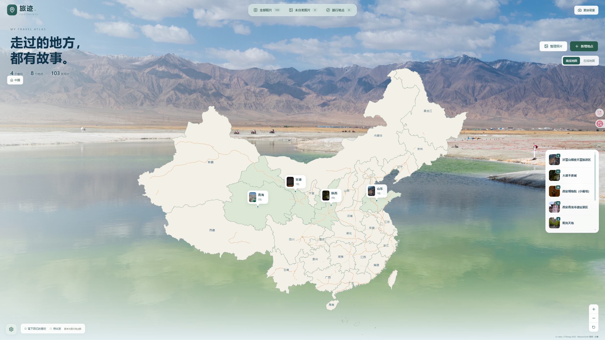

# 旅迹 · 个人旅行地图相册

把本地照片整理成自己的旅行地图，按地点回看旅途中的风景与回忆。

照片始终留在原来的文件夹中。旅迹只读访问原图，不会上传、移动、改名或删除原图。



## 开始使用

适用于 Windows x64，无需注册账号。桌面 ZIP 已内置运行环境，无需安装 Java、Node.js 或 Maven。

1. 下载桌面版 ZIP，**完整解压**到本地文件夹。
2. 双击 **旅迹.exe**，等待准备页面结束。
3. 点击**左下角设置齿轮 → 添加目录 → 选择文件夹**，添加照片目录后点击**手动扫描**。

支持 JPEG、PNG、WebP，也会读取子文件夹。以后添加了新照片，需要再次点击“手动扫描”。

用完后关闭窗口，程序会在保存数据后退出。再次双击会唤起已有窗口。

桌面版数据保存在 `%LOCALAPPDATA%\TravelRecording\data\`。更新时先退出，再将新版解压到另一文件夹，仍会使用原来的图库；不要删除用户数据目录。程序不会自动导入源码版图库。

<details>
<summary>第一次从 GitHub 下载源码？</summary>

源码需要先生成可运行程序：

1. 准备 Java 21 JDK，并配置 `JAVA_HOME`；安装 Node.js 24。
2. 双击 **Build.cmd**，等待构建成功。首次构建需要联网下载依赖。
3. 运行 **Start.cmd**。之后日常使用不必重新构建。

源码版双击 **Start.cmd** 后，用浏览器打开 [http://127.0.0.1:8080/](http://127.0.0.1:8080/)。源码版数据仍默认在项目 `data/`，停止时按 Ctrl+C；后台服务使用 **Stop.cmd**。开发者可用 **Build-Desktop.cmd** 生成桌面 ZIP，见[桌面构建说明](docs/桌面版开发.md)。

</details>

## 浏览和整理照片

| 入口 | 用途 |
| --- | --- |
| 左上角 LOGO | 返回全国旅行地图；点击省份、城市和地点封面浏览足迹、打开相册 |
| 全部照片 | 浏览、搜索照片，点击照片进入大图查看 |
| 未分类照片 | 为还没有归属地点的照片进行归类 |
| 旅行地点 | 查看和管理地点、地点下的照片类别 |
| 左下角设置齿轮 | 管理照片目录、扫描、备份与恢复 |

**新建地点：** 在地图首页点击“新增地点”，填写名称并选择位置，再添加照片。

**整理照片：** 在相册中批量选择照片，归入地点和类别；也可以直接新建类别。在地点相册中，可选择“在该地点归类”或“归入其他地点和类别”。重新归类会替换原类别；移到其他地点时，会清除旧地点的类别。

**查看大图：** 支持上一张／下一张、滚轮缩放、放大后拖动、全屏和底部缩略图。展开“照片信息”可查看原始路径、打开所在文件夹。

## 更换首页背景

在地图首页点击**更换背景 → 选择照片 → 确定**，进入预览后拖动取景、调整大小和透明度，最后点击**保存并应用**。

背景采用固定 16:9 取景，随页面等比缩放。保存后会保留取景和透明度，同一图库在不同浏览器中共用；其他页面不使用该背景。

## 备份与恢复

在**设置与数据 → 备份与恢复**中点击“导出备份”，保存下载的 ZIP 文件。

备份包含照片的整理信息、地点、类别和首页背景设置，**不包含照片原文件**。请另外备份原图。

目前仅支持恢复到**空图库**，不能合并或覆盖已有图库。恢复后，需再次确认照片目录的访问权限。

<details>
<summary>如何用新图库恢复备份？</summary>

桌面版可为 `旅迹.exe` 创建快捷方式，在目标末尾添加空格及 `--travel-user-dir="D:\旅迹新用户目录"`，指定一个全新用户目录，程序会在其中建立 `data` 和 `config`。打开后在设置中选择备份、预览并恢复；不要指向原图库或照片文件夹。

源码版在项目目录打开终端，运行：

```bat
.\Start.cmd -Port 8081 -DataDir ".\data\restore-library"
```

使用一个尚未存放图库数据的新目录。打开 http://127.0.0.1:8081/，进入设置，选择备份并预览，核对后确认恢复，再确认照片目录访问。

</details>

## 使用中可能遇到的问题

- **照片或文件夹移动了：** 单张照片可在失效的照片查看器中“重新定位”；整个目录可在设置中点击该目录的“重新定位”，核对后重新关联。
- **不想收录某些照片：** 选择“从图库排除”，原图仍留在电脑中；可在“设置与数据 → 已排除照片”中恢复。
- **没有网络或个人 Key：** 本地照片整理和离线地图仍可使用。桌面版在线地图配置位于 `%LOCALAPPDATA%\TravelRecording\config\application-local.properties`，填写 `app.geography.tianditu-key=个人服务端Key` 后退出重开。源码版使用项目 `config/` 下的[配置示例](config/application-local.properties.example)。
- **需要保留程序数据：** 桌面版在上述用户目录，源码版在项目 `data/`。复制整个数据目录前请先停止程序，不要仅复制运行中的数据库文件。
- **启动失败：** 提示中可打开日志文件夹。确认同一图库的其他入口已退出，再重新打开；不要删除锁文件或强停其他 Java 程序。

地图用于旅行记录和位置浏览，不用于导航，也不是经审定的标准地图。来源与许可见[地图资源说明](frontend/public/assets/README.md)。
