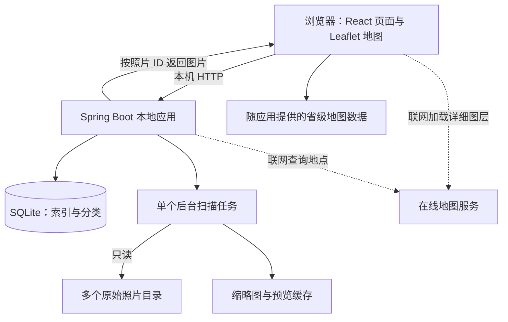

# 个人旅行地图相册 — 技术方案与迭代开发计划 V1.1

**编写日期：** 2026-10-22  
**文档状态：** 开发实施基线；阶段 0 前端 Demo 已运行并根据用户试用反馈修订，后端尚未开始；下一步为阶段 1 真实数据链路  
**文档内容版本：** V1.1；为保留既有引用，文件名仍含 V1.0  
**对应需求：** 《个人地图相册需求文档PRDv1.0.md》中的 PRD V1.2  
**产品交付：** 本地部署、浏览器访问的个人地图相册  
**开发方式：** AI 辅助完成代码实现，用户负责需求决策、体验与功能验收

> **2026-10-22 实施补记：** 阶段 1 首个真实闭环、一致性备份及空图库恢复已经实现；天地图 WMTS/搜索 V2 已用本机服务端 Key 接通。实际采用 Java 21、Spring Boot 4.1.1、MyBatis-Plus 3.5.17（Boot 4 starter）、SQLite JDBC 3.53.4.0、Flyway 12.4.0。以下选型表与阶段说明保留为实施基线，实际验证结果及后续缺口见 [阶段1实施记录](阶段1实施记录.md) 和 [地图服务与离线验证](地图服务与离线验证.md)。离线首次加载、正式地图内容及数据库升级演练仍待完成，不宣称阶段 1 或 MVP 全部完成。

> 本项目以个人使用和完成功能为主。采用简单的单体应用，不设置企业级并发、可用性或复杂业务流程目标。以下阶段是逐步交付的安排，不能把前端 Demo 或 MVP 当成完整 PRD 已实现。

## 1. 已确认的项目边界

| 项目 | 决定 |
|---|---|
| 使用方式 | 单人、本机使用，通过浏览器打开页面 |
| 照片位置 | 多个本地目录，原始照片不搬迁、不改名、不覆盖、不删除 |
| 前后端部署 | Java 服务与照片位于同一计算机；发布时由 Java 服务同时提供页面和接口 |
| 数据库 | SQLite，不要求额外安装数据库服务 |
| 地图 | 离线保留中国基础轮廓、省级边界、已有地点与导航；联网增加详细底图与新地点搜索 |
| 主要验收环境 | Windows 主机，当前稳定版 Chrome / Edge；其他环境验证后再承诺 |
| 产品容量 | MVP 约 5,000 张照片；正式 V1.0 验证 10,000～50,000 张，不设置数量硬性上限 |
| 范围外 | 桌面应用、Agent、账号、多用户协作、云端照片托管、自动照片内容识别 |

这里的 Web 应用包含后端，不是双击一个 HTML 文件就能扫描磁盘的纯静态网站。断开外部网络后，本机服务仍需运行；服务停止时页面不能继续执行照片管理操作。云端部署的后端不能直接读取访问者电脑上的 D、E 盘。

## 2. 推荐技术选型

### 2.1 主技术栈

| 层次 | 选择 | 用途及取舍 |
|---|---|---|
| 前端语言 | TypeScript | 明确页面数据结构，降低前后端字段不一致的问题 |
| 前端框架 | React + Vite | 构建地图、图库和管理页面，适合独立前端 Demo 后接入真实服务 |
| 页面组件与样式 | 复用 Demo 自定义 React 组件、CSS 和 Lucide 图标 | 保留现有视觉与交互；随组件拆分逐步整理样式，不要求改用 Ant Design 或重做界面 |
| 页面路由 | 正式前端接入 React Router | 地图、全部照片、未分类、地点图库、设置之间导航；保留当前省份和筛选上下文 |
| 接口数据 | 正式接口接入时使用 TanStack Query | 处理请求、加载状态、刷新和写入后的数据更新；Demo 目前尚未安装 |
| 大图库展示 | 规模验证时引入 TanStack Virtual | 只渲染可见范围附近的缩略图；先做分页，不为几十张验证数据提前增加复杂实现 |
| 后端语言 | Java 21 LTS | 采用成熟的 Java 业务开发生态，兼顾国内后端岗位展示 |
| 后端框架 | Spring Boot + Spring MVC | 一个应用提供页面、REST 接口和后台任务 |
| 数据访问 | MyBatis-Plus | 常规增删改查、分页及必要的自定义 SQL |
| 数据库与驱动 | SQLite + Xerial sqlite-jdbc | 应用数据存本机文件，无独立数据库服务 |
| 数据库迁移 | Flyway 的 SQL 版本迁移 | 保存表结构演进记录，不在升级时重建用户图库 |
| 图像解码与缩放 | Java ImageIO + TwelveMonkeys + Thumbnailator | 读取 JPEG/PNG/WebP、生成缩略图；具体格式兼容性在阶段 1 实测 |
| 图片元数据 | metadata-extractor | 读取方向、拍摄时间等；原始文件不做任何写入 |
| 地图组件 | Leaflet | 在同一地图中管理本地省级轮廓、地点标记及在线图层 |
| 在线地理服务 | 优先验证天地图官方地图接口与地名搜索 | 最终接入方式、Key、额度、坐标匹配与数据授权在阶段 1 确认 |
| 构建工具 | Maven Wrapper；前端 npm + package-lock.json | 固定依赖与构建入口，保持仓库结构简单 |
| 基本验证 | JUnit / Spring Boot Test、Vitest、少量 Playwright 流程 | 测数据保护和关键链路，常规界面以人工体验验收为主 |

界面交互状态优先使用 React 自身状态；出现明确需要时再引入额外状态库。应用日志使用 Spring Boot 自带日志体系，不单独部署日志平台。

### 2.2 版本与兼容性规则

- 后端以 Java 21 为目标，Spring Boot 4.1.x 为原方案的待验证候选；正式编码时按官方发布与支持信息核对可用稳定版本，再验证依赖及打包。候选版本号不代表本机已有可运行组合。[Spring Boot 系统要求](https://docs.spring.io/spring-boot/system-requirements.html)
- MyBatis-Plus starter 必须与实际采用的 Spring Boot 大版本对应；验证 Boot 4 候选时不能照搬 Boot 3 配置，也不重复引入不同版本的 MyBatis starter。[官方安装说明](https://baomidou.com/en/getting-started/install/)
- Flyway、SQLite 驱动及图像插件在阶段 1 锁定具体版本；验证空库初始化、升级和可执行 JAR 后再作为正式基线。Flyway 提供 SQLite 支持说明。[SQLite 迁移说明](https://documentation.red-gate.com/flyway/reference/database-driver-reference/sqlite)
- 前端现有依赖及锁文件见 `/demo/package.json` 与 `/demo/package-lock.json`；迁移正式前端时优先复用已构建通过的组合，不顺手全量升级。新增路由、请求和虚拟列表依赖时再验证兼容性。
- 目前只有前端 Demo 已运行，Java、SQLite、数据库迁移与图像插件组合尚未验证；不得把推荐选型写成已经通过的结论。

### 2.3 保持简单的实现原则

运行时只需要一个 Java 应用和一个本机 SQLite 文件。后台扫描采用一个普通任务执行器，同一时间处理一个扫描任务，页面轮询进度即可。

不建设微服务、分布式任务、复杂权限、通用工作流或多数据库适配框架。数据库迁移、必要事务、原图保护和一致性备份属于基本功能保障，仍应保留。开发按模块拆分即可，不引入复杂的领域架构。

## 3. 部署与代码结构

### 3.1 运行结构



**开发时：** Vite 提供页面，代理 `/api` 到本机 Java 服务。  
**发布时：** 前端构建产物放入 Spring Boot 静态资源目录，由同一个应用提供页面和接口。建议默认地址为 `http://127.0.0.1:8080`，端口可配置。

最终提供可执行 JAR、启动/停止脚本和使用说明。用户准备受支持的 Java 运行环境即可运行；Node.js 和前端构建工具仅为开发构建依赖。若需提供免配置运行环境，后续可附带 Java 运行时，但不因此开发桌面应用。

### 3.2 建议仓库结构

```text
Travel-Recording/
├── demo/                     当前可运行的交互基线，暂保留供对照
├── frontend/                 React 页面、组件、样式、Demo 数据
├── backend/                  Spring Boot 项目与 Maven Wrapper
│   └── src/main/
│       ├── java/.../         root、photo、place、category、backup 等模块
│       └── resources/
│           ├── db/migration/ 版本化 SQL
│           └── static/       发布时放入前端构建产物
├── scripts/                  构建、启动与停止入口
├── docs/                     PRD、技术方案和使用说明
└── README.md
```

每个业务模块按需要包含 Controller、Service、Mapper 和 DTO。照片处理、文件访问和地图服务各自放在小型工具/服务类中，不再增加多层通用抽象。

`frontend/` 从当前 `/demo` 提取和整理组件，接入真实 API；保留 Demo 作为已有体验的参考，避免长期维护两套独立演进的产品界面。当前尚无 `frontend/`、`backend/`，上述结构是实施目标。

### 3.3 数据目录

```text
<应用数据目录>/
├── album.db                  SQLite 数据库
├── thumbnails/               可重建的缩略图
├── previews/                 按需生成的预览图
├── backups/                  用户导出的备份
└── logs/                     简单运行日志
```

应用数据目录与原始照片目录分开。数据库必须放在本机磁盘；SQLite WAL 不适合把数据库文件放到网络共享盘。原始照片可以位于多个本机磁盘或移动硬盘。[SQLite WAL 说明](https://www.sqlite.org/wal.html)

## 4. 前端 Demo 与正式前端的衔接

### 4.1 已完成体验原型，继续复用

本产品最需要提前确认的是：地图入口是否清楚、照片网格是否好用、批量选择和分类是否顺手，以及地图与图库之间如何返回。先用示例数据走通这些操作，能够减少接入真实文件和数据库之后的界面返工。

Demo 已使用 React、TypeScript、Vite、Leaflet 和本地样式实现，后续继续复用页面和组件；它没有 Java、SQLite 或真实照片目录扫描，也不接触用户原始照片。当前 `/demo` 直接使用 React 状态和 localStorage，尚未完成正式 API 数据层拆分。

### 4.2 Demo 范围

| 内容 | 实现要求 |
|---|---|
| 页面骨架 | 旅行地图、全部照片、未分类、地点列表、设置入口 |
| 地图 | 本地省级轮廓与示例地点；点击省份放大，点击地点打开相册 |
| 示例图库 | 当前为 60 条照片记录、12 张授权示例照片；真实格式、透明图、方向与损坏图支持仍在阶段 1 另做样本验证 |
| 地点与类别 | 用内存数据模拟新增、改名、删除和类别筛选 |
| 批量分类 | 多选、已选数量、选择地点和多个类别、确认后更新界面 |
| 查看器 | 已有大图、上一张/下一张、缩放、全屏、信息面板及横向缩略图条；操作范围延续当前类别、搜索和排序 |
| 状态展示 | 空图库、加载、扫描进度、图片不可用、在线服务不可用 |
| 设置 | 目录、备份和路径恢复仅展示交互原型，明确标为模拟能力 |

Demo 默认用内存保存模拟操作，可选保存在浏览器中以便演示，并提供重置示例数据入口。模拟地名搜索使用少量固定候选，不能将它当成真实搜索服务。页面显示“示例演示，数据不代表真实图库”。

前端设一个简单的数据访问接口，提供 `demo` 与后续 `http` 两种实现即可；不要为此编写通用模拟平台。正式服务模式不导入示例图片和模拟分类。

这项数据层拆分属于正式开发的接入工作，不能假设当前 Demo 已具备。Demo 的 localStorage 和 JSON 导出格式不迁入正式 SQLite 图库；默认空图库启动，不自动扫描、导入用户目录或示例分类。

### 4.3 Demo 验收

用户能完成“查看未分类照片 → 多选 → 指定青海湖与类别 → 从地图进入青海湖 → 筛选类别 → 打开大图 → 返回地图”。同时确认主要布局、操作入口、选中反馈和空状态。

Demo 通过后进入真实数据开发。它不证明磁盘读取、数据持久化、图片格式兼容性或 5,000 张照片的性能，也不需要把 PRD 所有设置页面都做成完整功能。

### 4.4 已确定的交互与待接入能力

| 内容 | 正式开发要求 |
|---|---|
| 全国地图 | 省份高亮，省名旁显示紧凑足迹标签和地点数；不展示照片封面；悬停展示地点数、照片数 |
| 省内地图 | 只展示该省地点的封面缩略图、名称与照片数；没有可用封面时回退普通点位；可返回全国 |
| 照片查看器 | 保留底部横向缩略图条、当前项高亮、点击切换与方向键切换后自动定位；不遮挡大图 |
| 照片集合 | 图库、缩略图条和大图翻页使用相同地点、类别、搜索与排序条件；结果数量和数据来自后端 |
| 目录和照片 | 模拟扫描、固定候选、示例信息改为真实目录扫描、实际元数据和真实状态；未接入能力继续明确标识 |
| 数据保存 | 正式模式通过 API 保存到 SQLite；页面显示保存失败并可重试，不依赖 Demo 的 localStorage |

这套布局和交互是后续实现的基线，具体颜色、间距和组件细节可继续调整；用户试用反馈不等同于完成了所有浏览器、异常场景或容量验收。

## 5. 开发阶段与交付标准

先按交付结果安排，不设缺乏实际开发速度依据的固定周数。每阶段留一个可运行版本；阶段内按下面的小步骤推进。

### 阶段 0：前端交互 Demo

**目标：** 确认地图整理与浏览的核心体验。

**顺序：** 页面骨架 → 本地地图与示例图库 → 地点/类别 → 批量分类 → 查看器与状态页面。

**交付：** 可运行的前端 Demo、示例资源来源记录、核心流程演示与需要调整的交互清单。

**完成标准：** 第 4.3 节流程可实际点击完成，数据均明确为示例，用户能够判断操作是否符合预期。

### 阶段 1：打通真实技术链路

**目标：** 用很小的数据量确认选型可运行，解决高返工风险。

阶段 1 的首个交付是“手动添加一个测试目录 → 扫描 → 浏览真实缩略图 → 保存一条地点/类别关联 → 重启后仍在”。先完成这个闭环，再按下面的项目补齐阶段验证；不要一次实现完整 PRD。新对话的执行顺序与交付边界见《正式开发交接说明.md》。

1. 建立 Java 服务、SQLite、数据库迁移和最小前端接口调用。
2. 读取一个测试目录，验证中文路径、空格路径和只读访问。
3. 用 JPEG、PNG、WebP 实际生成缩略图；覆盖竖图方向、透明图、损坏图与一张大图。
4. 保存并读取一个地点、一张照片与一条分类关系，重启服务确认仍存在。
5. 做一次数据库备份和向空图库恢复。
6. 在无外网、浏览器无历史缓存时验证页面、基础地图与已有点位。
7. 验证在线地图/搜索服务与离线地图的同一组地点位置一致，记录地图数据来源、服务条件及配置方式。
8. 构建一次可执行 JAR，验证前端资源、SQLite 驱动、图像插件均能随包运行。

**交付：** 一个真实目录的最小纵向链路、依赖版本记录、运行说明及验证结果。

**完成标准：** 浏览器能显示真实照片，分类可持久保存，三种图片格式均通过样本验证。若图像插件或在线服务不适配，先修正并记录选型，再进入 MVP；不把问题拖到功能全部写完后处理。

### 阶段 2：MVP，形成可日常试用的闭环

**目标：** 约 5,000 张照片规模下可以实际整理和回看。

| 任务顺序 | 具体范围 | 完成时用户能看到什么 |
|---|---|---|
| 2.1 多目录 | 多根目录配置、递归扫描、重叠目录去重、手动增量刷新 | 不同目录照片合并在同一个图库，重复刷新不重复入库 |
| 2.2 图库 | 全部/未分类/地点图库、缩略图分批展示、基础大图切换 | 能浏览并辨认真实照片 |
| 2.3 地图与地点 | 离线基础地图、已有省份高亮与足迹标签、省份点击放大、省内地点封面、地点列表、创建/修改/删除地点；联网基础地名搜索、手动标点 | 能在地图上保存地点并进入相册，断网仍可回看 |
| 2.4 类别与归类 | 地点内类别管理、一次选取约 100 张照片归类、多类别筛选、变更/取消归属 | 照片正确离开未分类区，地点全部照片不重复 |
| 2.5 基本保存与保护 | 自动保存；文件缺失状态；损坏图片独立失败；详情显示路径并打开所在文件夹 | 重启后整理成果仍在，找不到原图时不会丢分类 |
| 2.6 基本备份 | 管理数据导出、向空图库恢复 | 能实际恢复一次地点、类别及照片关联 |
| 2.7 本地运行 | 构建、启动、停止和访问说明；断网资源完整 | 用户能自行运行 Web 应用，照片无需上传 |

**本阶段暂缓：** 服务启动自动扫描、复杂导航边缘情况、拖动修正坐标、地点内直接挑选照片的第二种归类入口、完整拍摄信息、单张/批量路径恢复、替换已有图库的恢复流程。Demo 已有的省份高亮、足迹标签、查看器缩略图条等交互优先复用并接入数据，不作为需要重做的后期功能；大数据量下的查看器优化可在下一阶段补齐。

**MVP 验收：**

1. 添加三个根目录，其中两个相互包含；同一实际文件只出现一次。
2. 对不同路径的相同内容照片分别建立记录。
3. 首次扫描后加入新照片，再扫描能发现新增；未变化照片不重复生成缩略图。
4. 创建“青海省 → 青海湖”，建立 A、B 类，将 100 张照片一次归入地点及两个类别。
5. 从中国地图进入青海省和青海湖，默认看到该地点全部照片，每张只出现一次；筛选 A、B 均可找到相关照片。
6. 修改地点时正确清除旧地点类别；取消地点后回到未分类区；删除管理记录不触碰原图。
7. 关闭页面和重启服务后，整理结果完整保留。
8. 外网断开并清空浏览器缓存后启动，基础地图、点位、照片和分类仍可使用。
9. 暂时移走一个照片目录，记录及类别保留，原图显示不可用；文件恢复到原路径后刷新可再次访问。
10. 导出备份并向空图库恢复，对照地点、类别和照片关联数量及内容。
11. 抽查原始照片内容与文件名，扫描、分类、备份后未发生修改。

这里的 5,000 张是阶段验收样本，不是产品数量上限，也不代表已经满足正式版 50,000 张要求。

### 阶段 3：补齐正式 V1.0 功能与发布

**目标：** 完整达到 Web 修订版 PRD 的第一版产品要求。

按以下顺序补全：

1. 服务启动自动扫描；网页刷新与多标签页不重复触发。
2. 完善地图返回导航和边缘情况、地图标记拖动修正及地点维护细节。
3. 从地点图库挑选已扫描照片的归类入口。
4. 完善查看器缩放、全屏、大量照片时的缩略图条、拍摄日期和图片详情；支持的元数据缺失时明确显示未知。
5. 单张重新定位、目录批量恢复、候选预览与歧义处理。
6. 备份恢复到已有图库：明确替换影响、先备份、失败回退，不建设图库合并功能。
7. 分别以 10,000 和 50,000 张照片验证扫描、浏览、分类与恢复，针对实际卡顿优化。
8. 完成启动说明、数据位置、备份恢复、地图配置、常见问题和发布包。

**完成标准：** PRD 的 AC-01～AC-21 逐项通过；保存测试环境与结果记录；没有会修改原图、丢失分类或错误强制关联文件的已知问题。普通界面瑕疵可记录后续改进，不以覆盖率或高并发指标阻塞个人可用版本。

### 5.1 与 PRD 的阶段对应

| PRD 功能 | MVP 状态 | 正式版补齐内容 |
|---|---|---|
| FR-001～008 目录与扫描 | 除 FR-003 外完成主要能力 | 服务启动自动扫描及异常提示完善 |
| FR-009～015 地图与地点 | 省份高亮/足迹、放大、省内地点封面、搜索、列表及手动创建可用 | 拖动与导航边缘情况等交互细节 |
| FR-016～024 类别与归类 | 类别、批量选择归类及调整可用 | FR-022 从地点内直接添加照片入口 |
| FR-025～031 图库与查看器 | 图库、大图及当前集合缩略图条、路径与文件夹定位可用；复用 Demo 的缩放/全屏 | 大规模浏览优化及完整照片元数据 |
| FR-032～036 路径失效与恢复 | 缺失提示、保留记录与原图保护 | 单张与批量重新定位 |
| FR-037～039 保存与备份 | 持久化、导出、向空图库恢复 | 替换已有管理数据的恢复及回退流程 |
| 容量与完整交付 | 约 5,000 张日常试用 | 10,000～50,000 张与全部验收场景 |

## 6. 后端业务与数据设计

### 6.1 最小模块

| 模块 | 职责 |
|---|---|
| 目录与扫描 | 配置目录、递归发现文件、识别变化、返回扫描进度 |
| 照片与缓存 | 索引查询、缩略图/预览图生成、原图读取、缺失状态 |
| 地点与地图 | 地点增删改查、已有地点搜索、在线地理服务接入 |
| 类别与归类 | 类别维护、批量修改地点和类别、分类筛选 |
| 备份与恢复 | 数据快照、校验与恢复；后续路径重新定位 |
| 本机操作 | 经用户点击打开已登记照片的文件夹 |

### 6.2 最小数据模型

| 表 | 主要字段 | 规则 |
|---|---|---|
| `photo_roots` | id、path、normalized_path、enabled、last_scan_at、status | 目录移除先停止扫描，保留已有记录 |
| `photos` | id、path、normalized_path、source_root_id、file_name、size、modified_at、width、height、taken_at、place_id、availability | 照片 ID 独立于路径；规范化路径唯一；地点可为空 |
| `places` | id、province_code、name、longitude、latitude、coordinate_system、coordinate_source | 坐标必须标明体系和来源 |
| `categories` | id、place_id、name | 类别属于一个地点；同地点名称按统一规则避免重复 |
| `photo_categories` | photo_id、category_id | 组合唯一；关联类别必须属于照片当前地点 |

ID 建议使用 UUID 字符串，直接作为 API 字符串传输，避免 Java 长整数在前端丢失精度。时间字段区分文件修改时间、业务保存时间和拍摄时间；无法确定拍摄时区时保留原始信息，不伪造时区。

表结构通过迁移脚本建立必要外键和索引。索引重点覆盖规范化路径、地点、类别关联、照片排序字段。`source_root_id` 只记录首次发现来源，不用于决定地点分类；重叠根目录仍根据规范化实际路径识别同一文件。

### 6.3 必须保持的简单规则

- 每张照片最多一个地点，可关联该地点下多个类别；无地点即未分类。
- 类别筛选查询使用 `EXISTS` 等方式避免重复照片。
- 更换地点：在一个事务内移除旧类别、更新地点、添加目标类别。
- 删除地点：先清除相关类别关联，再把照片地点置空；原始文件保留。
- 删除类别：只删除管理关联；照片地点保留。
- 批量操作先检查照片和类别是否有效，再一次提交；不要求复杂并发版本控制。

SQLite 每个连接开启 `foreign_keys`，配置合理的 `busy_timeout`。MVP 使用一个小连接池，可先限制为一个连接；图片解码、磁盘遍历和网络请求均在数据库事务外执行，避免长时间占用连接。开启 WAL、保持短事务即可，不额外建设锁服务。[SQLite 外键说明](https://www.sqlite.org/foreignkeys.html)

## 7. 照片扫描、缓存与路径恢复

### 7.1 扫描的最小流程

1. 校验根目录是否存在、可读，再提交单个后台扫描任务。
2. 逐步遍历文件，不一次把所有文件和图片读入内存；默认不跟随符号链接或目录联接，避免循环和越界。
3. 按扩展名筛选，并实际解码确认图片有效；不支持和损坏文件单独记录，继续扫描。
4. 规范化路径后查索引：没有记录则新增；路径、大小与修改时间未变化则跳过重复图片处理。
5. 新增或变化的照片读取基本信息并生成缩略图。照片文件发生变化时使旧缓存失效，但保留分类关联。
6. 用小批次、短事务保存结果；页面轮询状态显示已发现、新增、更新和失败数量。
7. 某根目录完整扫描成功后，才检查其范围内未再发现的旧文件并标记不可用。

同一时间只执行一个扫描任务。再次点击刷新时，返回当前进度或提示正在扫描，不创建第二套任务。进度初期可以显示已处理数量，不强行先遍历一遍计算精确百分比。

当前任务状态可先保存在进程内存中，前端每约 1～2 秒查询一次；不建设持久化任务队列和断点续扫。服务异常退出后，已提交的照片和分类仍在；下次重新扫描会跳过未变化文件，安全补齐未完成部分。

根目录离线、权限错误、子目录访问失败或扫描中断时，本轮不据此批量判定该根目录的文件缺失。无论何种缺失状态都不自动删除分类。Windows 路径去重需处理分隔符、尾分隔符、大小写及真实路径；不同路径的相同内容照片不做内容合并。

根目录不可访问时，页面仍应根据目录状态或实际图片读取失败显示“照片不可用”；这与保留照片记录、暂不执行扫描差集判断是两回事。目录恢复访问并刷新后，照片可恢复显示。

### 7.2 图片与缓存

缩略图建议从长边约 320～480 像素开始验证；预览图按查看器需求按需生成。缓存放在独立目录，缓存标识包含照片 ID 和文件版本信息；先写临时文件，成功后替换缓存。

JDK ImageIO 的内置格式列表没有 WebP，不能只依赖 JDK 默认解码器。优先验证 TwelveMonkeys 的 WebP 读取插件，Thumbnailator 负责缩放，metadata-extractor 读取方向及拍摄信息；通过可执行 JAR 样本测试后才认定三种格式支持完成。[JDK ImageIO 格式说明](https://docs.oracle.com/en/java/javase/21/docs/api/java.desktop/javax/imageio/package-summary.html)、[TwelveMonkeys](https://github.com/haraldk/TwelveMonkeys)、[Thumbnailator](https://github.com/coobird/thumbnailator)、[metadata-extractor](https://github.com/drewnoakes/metadata-extractor)

缩略图展示时应用原图方向信息，保留透明图片的合理效果。限制同时解码的图片数量，对异常尺寸或解码失败显示占位，不让单张照片终止扫描。原图读取使用流式响应，图库不一次下载所有原图。

不提前为全部照片生成高分辨率预览；后续观察缓存体积，再增加简单的清理入口即可。

### 7.3 正式版路径恢复

照片 ID 与分类关系不因路径失效而变化。单张恢复让用户指定新文件并预览确认；批量恢复先按新旧根目录及相对路径生成候选，再检查文件大小、元数据及可用的指纹信息。

只有确定的对应关系才进入恢复清单；同名、同大小本身不能证明是同一照片。存在多个候选或证据不足时展示旧缩略图和新预览，由用户确认或跳过。不为恢复而移动或改写原文件。

若需要使用内容哈希，只对恢复候选按需计算；旧文件已经缺失且没有预存哈希时，不能声称通过哈希验证了原文件身份。不要为了这项后续功能在 MVP 对所有原图做全量内容查重。

## 8. 地图与离线行为

### 8.1 同一地图中的两类资源

**本地资源：** 省级 GeoJSON、界面脚本、样式、图标及必要字体，随应用发布；保存地点坐标来自 SQLite。Leaflet 支持 GeoJSON 和图层交互。[官方文档](https://leafletjs.com/reference)

**联网资源：** 供应商明确提供的详细图层和地名搜索。优先验证天地图官方接口，不依靠未公开瓦片地址。在线地点搜索经后端固定的服务地址请求，不传照片内容。[天地图地名搜索](https://lbs.tianditu.gov.cn/server/search2.html)

离线或服务失败时保留基础地图、已有地点和地图导航，仅提示详细底图/新地点搜索不可用。已保存地点的名称搜索由本地数据完成。基础地图本身异常时才用地点列表回退。

### 8.2 地图数据与坐标

- 省级边界数据必须确认来源、内容完整性及随应用分发条件；在仓库记录资源来源与授权说明，不直接把来源不明的数据当成产品资源。
- 在阶段 1 确定统一的内部经纬度基准与离线数据；保留在线服务返回的原始坐标体系和来源，显示时进行明确适配。
- 不把 WGS84、GCJ-02、BD-09 等坐标直接混用。供应商坐标体系不同可能导致标记偏移，应以已知地点实测。[百度官方坐标说明](https://lbsyun.baidu.com/skins/MySkin/resources/iframs/coordinate.html)
- 在线服务 Key 通过本机配置提供，不写入公开仓库或备份。没有 Key 时基础地图与手动标点仍然可用；正式在线功能需完成真实接入验收。
- 默认不抓取和打包在线详细底图作为离线资源。离线能力由本地基础地图保证。

## 9. Web 接口与本机文件能力

以下为接口方向，具体字段在阶段 1 联调时形成简单的 OpenAPI 文档；不要求一开始生成整套客户端代码。

| 接口方向 | 用途 |
|---|---|
| `GET/POST /api/roots` | 查询和添加根目录 |
| `PATCH /api/roots/{id}` | 修改扫描启用状态等配置 |
| `POST /api/scans`、`GET /api/scans/current` | 发起扫描、查询当前状态 |
| `GET /api/photos` | 分页查询全部、未分类、地点或类别照片 |
| `GET /api/photos/{id}` | 照片信息与关联 |
| `GET /api/photos/{id}/thumbnail`、`/preview`、`/original` | 返回对应图片资源 |
| `POST /api/photos/classify` | 按照片 ID 批量修改地点与类别 |
| `GET/POST/PATCH/DELETE /api/places...` | 地点管理；删除前展示影响 |
| `GET/POST/PATCH/DELETE /api/categories...` | 地点内类别管理 |
| `GET /api/geography/search` | 在线地点搜索 |
| `POST /api/photos/{id}/reveal` | 用户主动请求打开原文件所在目录 |
| `POST /api/backups/export`、`/restore` | 导出和恢复管理数据 |

照片分页先采用普通页码和合理页大小，默认约 100、最大约 200；结合索引和前端虚拟滚动即可，出现实际问题后再优化查询。批量选择保存照片 ID，MVP 的全选明确为当前页，避免误选整库。

大图翻页与底部缩略图条共用图库的查询条件和稳定排序，日期或文件名相同的记录用 ID 作为次级排序键。接近已加载数据边缘时继续获取相邻分页；可以增量加载或窗口化，不一次下载全库原图，也不能把当前一页误称为整个类别。分类写入后同时刷新图库、查看器集合、地点及全国统计，避免数量不一致。

文件资源接口只接受已登记照片 ID，由后端解析路径并校验，不能提供任意路径文件下载接口。根目录在页面输入或由后端支持目录浏览；浏览器的目录选择句柄不能直接充当 Java 服务的绝对路径。

“打开所在文件夹”限定本机 Windows 桌面会话，由用户点击触发，后端校验照片 ID 后调用文件管理器。使用固定程序和参数调用，不拼接任意 shell 命令；失败时说明原因并提供复制路径。服务若以无桌面会话方式运行，应明确说明此能力不可用。

服务默认仅绑定回环地址；生产页面和接口同源，限制 Host/Origin，状态修改使用 CSRF 防护。保持原图只读、目录访问范围可控；备份导入的旧路径先校验，不自动获得任意目录访问权限。这些是本地文件应用的基本保护，不扩展为账号和权限平台。

## 10. 管理数据备份与恢复

### 10.1 导出

备份采用 ZIP 包，包含一致的 SQLite 快照及简单 JSON 清单：备份格式版本、应用版本、数据库版本、导出时间和文件校验值。它覆盖根目录、照片索引、地点、类别和关联关系，不包含原图、地图 Key 或日志；缩略图可重建。

使用 SQLite Backup API 或 `VACUUM INTO` 等一致性方式生成快照。不能直接复制正在写入的 `.db` 主文件并忽略 WAL。[SQLite 备份说明](https://www.sqlite.org/backup.html)

### 10.2 恢复

MVP 只向空图库恢复；不支持合并两套图库。先在临时目录检查备份格式、数据库完整性和支持的版本，不执行备份附带的任意脚本。恢复时暂停扫描、关闭数据库连接，再切换到校验后的数据库并重新打开。

正式版支持替换已有管理数据：先展示影响并要求确认，自动保留一份当前数据库的恢复前快照，失败时回退。原照片路径变更的情况由重新定位功能处理，不能在恢复时随意把相似文件强行关联。

数据库升级同样使用迁移脚本并保留升级前快照；升级失败应提示并保留可恢复资料。实际做过一次备份和恢复演练，才算这项功能完成。

## 11. 开发协作与验收方式

### 11.1 适合 AI 编码的小任务

每个任务写清：要完成的用户操作、涉及页面/接口、数据变化、不得影响的原文件、验证步骤。一次完成一个可演示的结果，例如“扫描一个目录并看到缩略图”，再扩展为多目录，避免一次提交整份 PRD 要求全部生成。

任务完成时保留：

- 可运行结果及启动方式。
- 实现了什么、尚未实现什么。
- 对数据表、接口或依赖做了哪些必要变化。
- 已执行的关键检查与用户体验验收步骤。

### 11.2 适度验证

重点自动检查四类内容：分类规则与事务、重复扫描和缺失保留、原文件保护、备份恢复。界面主要通过人工试用，加少量核心流程自动验证即可，不设置覆盖率或复杂并发门槛。

性能验证以个人实际体验为准：扫描时能继续浏览；滚动不会持续卡住；打开大图能够及时反馈；重启无需重新整理。正式版使用 10,000 与 50,000 张样本记录启动、扫描、图片显示、内存和缓存体积，发现问题后再优化，不提前规定未经测试的毫秒级指标。

发布时记录硬件、磁盘、浏览器、照片格式/分辨率组成及缓存状态，区分首次扫描与再次刷新，不把示例照片 Demo 的速度当成真实图库性能。

### 11.3 开源交付

先提供清楚的 README、界面截图、启动说明、功能边界和示例演示。源码与资源按各自授权记录，个人照片、数据库、备份、缓存、日志和地图 Key 不提交仓库。

如后续需要在线演示，仅部署示例数据版本；它不能读取访问者电脑目录，也不能代替本地完整产品。GitHub 展示以可运行、易体验、说明完整为重点，不为展示额外扩展业务。

## 12. 尚需在开发中验证的事项

| 事项 | 验证阶段 | 通过条件 |
|---|---|---|
| 省级边界数据来源与分发 | 阶段 0～1 | 资源可用、来源明确，断网可随应用加载 |
| 在线地图与搜索供应商 | 阶段 1 | 官方接入可用，Key 配置清楚，与离线坐标匹配 |
| Spring Boot / MyBatis-Plus / SQLite / Flyway 版本 | 阶段 1 | 初始化、事务、迁移、备份和可执行 JAR 通过 |
| JPEG/PNG/WebP 与方向 | 阶段 1 | 实际图片可解码，缩略图方向正确，失败不影响其他文件 |
| Windows 文件夹定位 | 阶段 1～2 | 同机桌面会话下可打开，中文和空格路径通过 |
| 个人图库规模 | 阶段 2～3 | 约 5,000 张可试用，最终 10,000～50,000 张通过 PRD 验收 |

这些是后续实际编码的验证任务，不是要求用户提前处理的审批事项。阶段 0 前端 Demo 已创建于项目 `/demo`，详见该目录 README；真实 Java 后端、SQLite 图库和磁盘扫描尚未实现。

## 13. 文档变更记录

| 版本 | 日期 | 内容 |
|---|---|---|
| V1.0 | 2026-10-22 | 建立本地 Web、Java + Spring Boot + SQLite 的技术基线；定义前端 Demo、技术链路、MVP 和正式版阶段；按个人使用、功能优先简化架构 |
| V1.1 | 2026-10-22 | 同步 PRD V1.2、已运行 Demo 与用户反馈；沿用现有组件和样式；明确正式数据层拆分、缩略图分页语义及首个真实目录闭环；增加开发交接入口 |

### 阶段 0 实施记录（2026-10-22）

- `/demo` 提供 React + TypeScript + Leaflet 交互原型、60 张照片记录、12 张本地示例照片和 34 个省级区域的演示地图。
- 已实现地图/图库导航、批量分类、地点与类别管理、基础查看器、模拟目录状态及演示数据导入导出。
- 已根据用户浏览器截图与批注补充：全国地图不显示照片，使用省份足迹与数量；进入省份才显示地点封面；查看器增加当前集合横向缩略图条。
- 生产构建、10 项模型测试及静态资源服务检查通过；用户已进行浏览器试用并反馈。代理浏览器工具的安全策略阻止本机自动预览，未完成自动视觉/点击验收或全面人工验收。
- 地图采用 Natural Earth 公共领域资源，仅供交互示意；正式产品地图数据仍按阶段 1 核对。素材来源、许可和启动方法保存在 `/demo/README.md` 与素材清单中。
